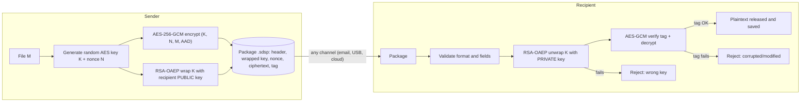

# Secure Document Sharing System (Artifact 1)
Introduction to Cryptography - BS Semester VII | Educational prototype, **not** production software.

A sender encrypts a file for one intended recipient. The recipient decrypts it, and the system
rejects any file that was modified, corrupted, or addressed to a different key.

## 1. Cryptographic design (hybrid encryption)
| Purpose | Mechanism | Why |
|---|---|---|
| Encrypt + authenticate the file | **AES-256-GCM** (authenticated encryption) | Fast for large files; the tag detects any change |
| Protect the file key for the recipient | **RSA-3072 with OAEP** (SHA-256) | Only the private-key holder can recover the key; OAEP padding is randomized and secure (no textbook RSA) |
| Keys / nonces | OS CSPRNG (`os.urandom`, `AESGCM.generate_key`) | Never ordinary PRNGs |
| Binding the header | Header + wrapped key + nonce used as GCM **associated data** | Editing filename, recipient, or key block is detected |
| Private key at rest | PKCS#8 encrypted with a passphrase | Stolen key file is not directly usable |

Formula from the brief: `(C, T) = AES-GCM.Enc(K, N, M, A)`; `K` is wrapped as `RSA-OAEP.Enc(pk_recipient, K)`.
`K` is fresh per file and `N` is fresh per encryption, so a nonce is never reused with a key.

## 2. Architecture


## 3. Package format (`.sdsp`, UTF-8 JSON, binary fields base64)
| Field | Meaning | In AAD? |
|---|---|---|
| `format`, `version` | `"SDSP"`, `1` | yes |
| `aead`, `kem` | `AES-256-GCM`, `RSA-OAEP-SHA256` | yes |
| `recipient_fp` | SHA-256 fingerprint of the recipient public key | yes |
| `filename` | original file name (basename only, **not encrypted**) | yes |
| `wrapped_key` | RSA-OAEP-encrypted AES key | yes |
| `nonce` | 12 random bytes | yes |
| `ciphertext` | encrypted file | covered by tag |
| `tag` | 16-byte GCM authentication tag | - |

## 4. Run it
```bash
pip install -r requirements.txt
python -m sdsp.cli keygen  --name bob                       # recipient makes keys; shares bob.public.pem
python -m sdsp.cli fingerprint --pub keys/bob.public.pem    # confirm fingerprint with Bob by phone
python -m sdsp.cli encrypt --in exam.pdf --pub keys/bob.public.pem
python -m sdsp.cli decrypt --in exam.pdf.sdsp --priv keys/bob.private.pem --outdir decrypted
streamlit run streamlit_app.py                              # optional GUI
python run_tests.py                                         # runs 20 tests, writes tests/TEST_REPORT.md
```
Status messages: `[SUCCESS]`, `[WRONG KEY]`, `[CORRUPTED / MODIFIED FILE]`, `[MALFORMED PACKAGE]`, `[UNSUPPORTED INPUT]`.

## 5. Deploy on Streamlit Community Cloud
1. Create a GitHub repository and add the **contents of this project directory** to its root, including `streamlit_app.py`, `requirements.txt`, and the `sdsp/` directory. Do not upload the parent-folder launcher in place of this app.
2. In [Streamlit Community Cloud](https://share.streamlit.io/), sign in with GitHub and choose **Create app**.
3. Select the repository and branch, set the main file path to `streamlit_app.py`, and deploy. Streamlit installs the dependencies listed in `requirements.txt`.

This is an educational prototype, not a production document service. The app has no user authentication, and uploaded files, private keys, and passphrases are processed by the hosted server. Do not use real confidential documents or keys on a public deployment.

## 6. Requirement checklist (from the brief)
- Select and encrypt a file; fresh key per file - done (`encrypt_file`)
- Package with nonce, ciphertext, tag, protected key - done (section 3)
- Decrypt only after authentication - done (plaintext returned/written only after tag check; test T9)
- Clear status messages - done (CLI and GUI)
- Private keys out of package and logs - done (tests T6, T8)
- Test plan items 1-6 - done (tests T1-T6, see `tests/TEST_REPORT.md`)

## 7. Threat model and residual risks
| Threat | Handled? |
|---|---|
| Eavesdropper reads the file | Yes - AES-256-GCM |
| Attacker edits ciphertext, tag, nonce, header, key block | Yes - rejected |
| Wrong person opens it | Yes - RSA-OAEP + fingerprint check |
| Sender used an attacker's public key (fake identity) | **No** - verify the fingerprint out-of-band; no certificates here |
| Package is not signed, so the *sender* is not authenticated | **No** (extension: add RSA-PSS signature) |
| Recipient's computer is infected / recipient leaks the file | **No** - endpoint compromise is out of scope |
| Lost private key | Data is unrecoverable; back up the key securely |
| Revocation | Deleting a key cannot recall a file already downloaded |
| Filename and file size are visible | Yes, visible (metadata is not protected) |
| Very large files | Whole file is loaded in memory (limit 256 MB) |

## 8. Extensions you can add (for extra marks)
Multiple recipients (wrap K once per recipient), signed packages (RSA-PSS), key rotation, encrypted filename.
